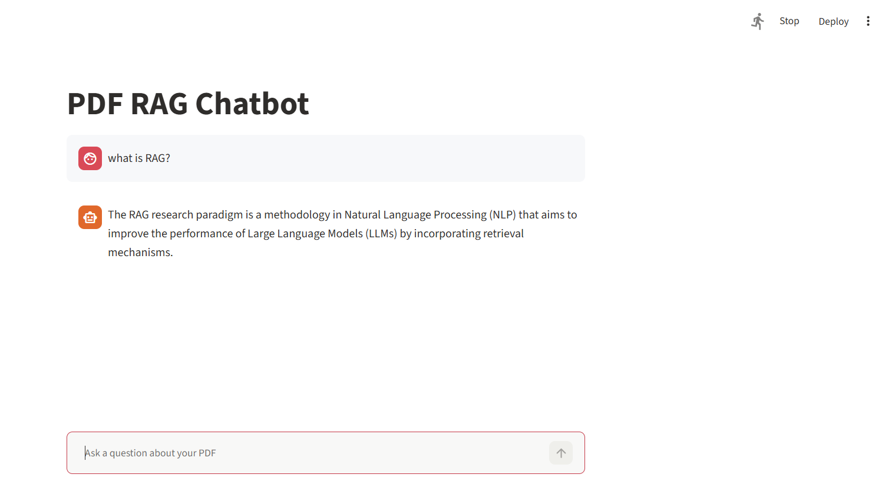

# RAGP – Retrieval-Augmented Generation PDF Assistant

RAGP is an end-to-end Retrieval-Augmented Generation (RAG) project that enables users to interact with PDF documents and obtain context-aware answers using locally hosted Large Language Models (LLMs).

The project implements the complete RAG workflow, including document ingestion, text chunking, embedding generation, vector storage, semantic retrieval, and response generation using LangChain and Ollama.



## Project Overview

The objective of this project is to understand and implement the core components of a RAG system. The initial stages of document ingestion, embedding generation, and vector database creation were implemented in Jupyter notebooks. The retrieval and generation pipeline was then integrated into a Python application using Streamlit.

The primary focus of the project is on RAG architecture, LangChain integration, semantic search, vector databases, and local LLM inference rather than UI development.

## Tech Stack

- Python
- LangChain
- LangChain Community
- LangChain Core
- LangChain Text Splitters
- Ollama
- Llama 3.2
- Nomic Embed Text
- Hugging Face
- Sentence Transformers
- FAISS
- PyMuPDF
- Streamlit
- Jupyter Notebook

## Project Structure

```text
RAGP/
│
├── 01_data_ingestion.ipynb
├── 02_embeddings_vector_store.ipynb
├── 03_retrieval_experiment.ipynb
│
├── src/
│   └── ragp/
│       └── app.py
│
├── vector_store/
│   └── faiss_index/
│
├── requirements.txt
├── README.md
└── 1.png
```

## File Descriptions

### 1. `01_data_ingestion.ipynb`

This notebook implements the document ingestion stage of the RAG pipeline.

Key functionalities:

- Loading PDF documents using PyMuPDF.
- Extracting text from PDF files.
- Processing the extracted document content.
- Preparing documents for downstream processing.

This stage converts raw PDF documents into a structured format suitable for the RAG pipeline.

### 2. `02_embeddings_vector_store.ipynb`

This notebook implements the embedding generation and vector storage stage.

Key functionalities:

- Splitting documents into smaller text chunks.
- Generating embeddings for document chunks.
- Converting text into numerical vector representations.
- Creating a FAISS vector database.
- Storing document chunks and their embeddings.
- Persisting the vector store for future retrieval.

The generated FAISS index is stored in the `vector_store/faiss_index/` directory.

### 3. `03_retrieval_experiment.ipynb`

This notebook focuses on understanding and experimenting with the retrieval component of the RAG architecture.

Key functionalities:

- Performing semantic similarity search.
- Retrieving relevant document chunks based on user queries.
- Understanding how query embeddings relate to document embeddings.
- Exploring the retrieval process before integrating it into the application.

This stage helps establish how relevant context is selected from the vector database.

### 4. `app.py`

This is the main application file that integrates the RAG pipeline with Streamlit.

Key functionalities:

- Loading the persisted FAISS vector database.
- Initializing the embedding model.
- Configuring the Ollama LLM.
- Creating a LangChain retrieval chain.
- Retrieving relevant document context based on user queries.
- Passing retrieved context to the LLM.
- Generating context-aware responses.
- Providing a basic Streamlit interface for interacting with the PDF knowledge base.

The application connects the document retrieval process with LLM-based answer generation to complete the end-to-end RAG workflow.

### 5. `vector_store/faiss_index/`

This directory contains the persisted FAISS vector database.

It stores the document vector index and associated document information required for semantic retrieval.

The vector store is reused during application execution, avoiding the need to regenerate embeddings every time the application starts.

### 6. `requirements.txt`

This file contains the dependencies required to execute the project.

The dependencies include LangChain packages, PyMuPDF, FAISS, Hugging Face embedding libraries, Ollama integration, Streamlit, and Python environment utilities.

## RAG Architecture

The project follows the standard Retrieval-Augmented Generation architecture.

```text
PDF Documents
     |
     v
Document Ingestion
     |
     v
Text Extraction
     |
     v
Text Chunking
     |
     v
Embedding Generation
     |
     v
FAISS Vector Database
     |
     v
User Query
     |
     v
Semantic Retrieval
     |
     v
Relevant Context
     |
     v
LangChain Retrieval Chain
     |
     v
Ollama LLM
     |
     v
Context-Aware Answer
```

## Implementation Workflow

### Document Processing and Indexing

The PDF documents are loaded and processed using PyMuPDF. Extracted text is divided into smaller chunks using LangChain text splitters.

Each chunk is converted into a vector representation using an embedding model. The generated vectors are stored in a FAISS vector database for efficient similarity-based retrieval.

### Retrieval

When a user submits a question, the query is converted into an embedding representation. FAISS performs semantic similarity search to identify the most relevant document chunks.

The retrieved chunks provide the contextual information required for answer generation.

### Generation

The retrieved context and user query are passed through a LangChain retrieval chain to the locally hosted Ollama LLM.

The LLM generates a response grounded in the retrieved document context.

### Application Integration

The complete retrieval and generation pipeline is integrated into the Streamlit application.

The interface allows users to submit queries and view responses generated from the PDF knowledge base.

## Challenges Encountered

### 1. Transitioning from Notebook Implementation to Python Application

The document ingestion, embedding generation, and vector database creation stages were initially implemented in Jupyter notebooks.

Integrating these components into a standalone application required understanding how to reuse the persisted vector store and connect the retrieval pipeline with the LLM.

### 2. Ollama Model Availability

During LLM integration, the following error was encountered:

```text
ollama._types.ResponseError:
model 'llama3.2' not found (status code: 404)
```

The issue occurred because the requested model was not available locally.

It was resolved by downloading the required model through Ollama.

```bash
ollama pull llama3.2
```

The embedding model was also configured locally.

```bash
ollama pull nomic-embed-text
```

### 3. Python Environment and Module Imports

During development, issues were encountered with Python module imports and virtual environment activation while transitioning from notebook-based experimentation to Python application execution.

These issues were resolved by configuring the project virtual environment and installing the required dependencies.

## Installation and Setup

### 1. Clone the Repository

```bash
git clone <repository-url>
cd RAGP
```

### 2. Create a Virtual Environment

```bash
python -m venv .venv
```

### 3. Activate the Virtual Environment

Windows PowerShell:

```powershell
.\.venv\Scripts\Activate.ps1
```

### 4. Install Dependencies

```bash
pip install -r requirements.txt
```

### 5. Download Ollama Models

```bash
ollama pull llama3.2
ollama pull nomic-embed-text
```

### 6. Run the Application

```bash
streamlit run src/ragp/app.py
```

## Key Learning Outcomes

- Understanding the end-to-end Retrieval-Augmented Generation architecture.
- Implementing document ingestion and text preprocessing.
- Understanding document chunking strategies.
- Generating embeddings using local embedding models.
- Building and persisting FAISS vector databases.
- Implementing semantic similarity-based retrieval.
- Integrating retrieval with LLMs using LangChain.
- Working with locally hosted LLMs through Ollama.
- Developing a modular RAG application using Python and Streamlit.
- Understanding the relationship between retrieval quality and generated response quality.

## Future Scope

- Experimenting with different chunk sizes and overlap strategies.
- Improving retrieval relevance and accuracy.
- Implementing hybrid search.
- Integrating reranking techniques.
- Adding source document references to generated responses.
- Evaluating retrieval and generation quality.
- Extending support for multiple PDF documents.
- Improving conversational context handling.

## Conclusion

RAGP demonstrates the implementation of an end-to-end Retrieval-Augmented Generation system using LangChain, FAISS, and Ollama.

The project covers the complete workflow from PDF ingestion and embedding generation to semantic retrieval and context-aware answer generation. Notebook-based experimentation was used to understand the initial RAG components, while the final pipeline was integrated into a Python-based Streamlit application.

The primary emphasis is on practical implementation and understanding of RAG concepts, vector databases, embeddings, retrieval mechanisms, and local LLM integration.